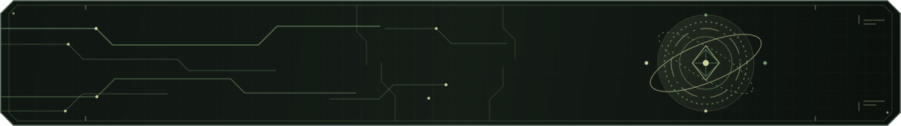

# Building systems that help people build.

**Miguel Enriquez · AI & systems engineering.**

🌐 [Portfolio](https://eldermael.io/) · ✉️ [Contact](https://eldermael.io/contact-me) · 📄 [Résumé](https://eldermael.io/resume-mael.pdf) · [LinkedIn](https://www.linkedin.com/in/eldermael/)

🤖 **AI & software** · ⚙️ **Platforms & DevOps** · 🗃️ **Data engineering**

## 🛠️ Selected open-source work

- [Helm chart webhook fix](https://github.com/open-telemetry/opentelemetry-helm-charts/pull/1391) — Stops disabled admission webhooks from remaining referenced for CRD conversion.
- [ClickHouse exporter DDL](https://github.com/open-telemetry/opentelemetry-collector-contrib/pull/35903) — Adds the missing exponential histogram and gauge table DDL examples.
